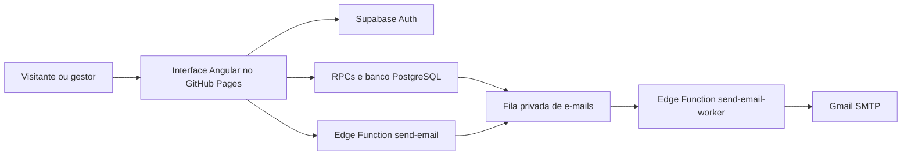

# Espaço TX · Família Teixeira

Aplicação do salão de festas Família TX, em Teodoro Sampaio. O visitante conhece o espaço, consulta o calendário e solicita uma pré-reserva. A equipe utiliza uma área restrita para consultar clientes, registrar pagamentos, negociar valores, reprovar reservas e controlar despesas.

**Site:** https://www.salaoespacotx.com.br/

**Área restrita:** https://www.salaoespacotx.com.br/?area=restrita

Este documento explica como executar o projeto, como as partes se comunicam e onde alterar cada funcionalidade.

## 1. Como o sistema está organizado

| Parte | Responsabilidade | Onde funciona |
|---|---|---|
| Angular 20 | Telas, formulários, calendário e painel | Navegador do visitante ou gestor |
| GitHub Pages | Disponibilizar os arquivos estáticos gerados pelo Angular | Hospedagem do site |
| Supabase | Banco PostgreSQL, autenticação, permissões e regras de negócio | Serviço externo ao GitHub Pages |
| Edge Functions | Validar solicitações de e-mail e processar a fila de envio | Supabase, com Deno |
| Gmail SMTP | Enviar as mensagens montadas pelo sistema | Conta Gmail configurada pela equipe |

O GitHub Pages hospeda a interface. Ele não executa banco de dados nem envia e-mails. Essas operações pertencem ao Supabase e ao Gmail. Não é necessário manter um servidor Node.js próprio em produção; Node.js é usado para desenvolvimento, testes e geração do site.

Embora existam arquivos de inicialização de servidor, a publicação é estática: o Angular gera o HTML durante o build (**prerender**) e o navegador assume a interatividade ao carregar o site (**hidratação**). O GitHub Pages não executa esses arquivos de servidor a cada visita.

Um fluxo simplificado:



**RPC** é uma função do banco chamada pela aplicação. Em vez de o navegador alterar qualquer campo diretamente, ele solicita uma operação específica, como criar uma reserva ou registrar um pagamento. O banco confere as permissões e valida os dados.

## 2. Instalação e primeira execução

### Pré-requisitos

- Git, para obter o projeto.
- Node.js **22.17.1**, versão registrada em [`.nvmrc`](.nvmrc).
- npm, instalado junto com Node.js.
- Acesso à internet e a um projeto Supabase configurado para testar os formulários e o painel.

### Obter o código e instalar as dependências

```bash
git clone https://github.com/a13xandr3/salao-festas.git
cd salao-festas
```

Se utilizar o gerenciador de versões **nvm**, selecione a versão do projeto:

```bash
nvm install
nvm use
```

Instale as versões registradas no `package-lock.json` e inicie o Angular:

```bash
npm ci
npm start
```

Abra **http://localhost:4209/**. Para o login administrativo, use **http://localhost:4209/?area=restrita**.

Se já tiver o repositório, execute os comandos na pasta que contém `package.json`, `angular.json` e este README. Não é necessário instalar o Angular CLI globalmente: os scripts npm usam a versão local.

### Antes de testar com dados

O frontend usa o Supabase indicado em [`public/app-config.json`](public/app-config.json), inclusive quando executado no seu computador. Rodar `npm start` não cria um banco separado.

Para desenvolvimento, configure um projeto Supabase próprio antes de preencher os formulários. Uma submissão válida pode gravar dados e enfileirar e-mails reais. Os testes automatizados descritos adiante utilizam simulações ou PostgreSQL local.

## 3. Configuração pública e privada

### Configuração que o navegador pode ler

Edite [`public/app-config.json`](public/app-config.json):

```json
{
  "supabaseUrl": "https://SEU-PROJETO.supabase.co",
  "supabasePublishableKey": "sb_publishable_SUA_CHAVE_PUBLICA",
  "contractUrl": "documents/contrato-de-locacao-espaco-tx.pdf",
  "pixUrl": "pix.html"
}
```

| Campo | Significado |
|---|---|
| `supabaseUrl` | Endereço HTTPS do projeto Supabase |
| `supabasePublishableKey` | Chave pública `publishable` ou chave legada `anon` |
| `contractUrl` | Caminho ou endereço HTTPS do contrato que o cliente pode baixar |
| `pixUrl` | Caminho ou endereço HTTPS da página de pagamento |

Todo esse arquivo é público. Senhas, `service_role` e chaves `sb_secret_` não pertencem a ele. A chave pública identifica a aplicação; as permissões efetivas são verificadas pelo Supabase.

O serviço `SiteConfig` valida essa configuração e resolve os caminhos relativos a partir da base do site. Recursos HTTP são permitidos apenas no desenvolvimento local por loopback; em produção, utilize HTTPS.

### Configuração privada do envio de e-mails

Para preparar ou administrar o backend de e-mail, copie o modelo:

```bash
cp .env.example .env
```

Preencha o `.env` local com os dados da conta autorizada a enviar mensagens. Ele não é necessário para executar apenas a interface conectada a um backend já configurado.

| Variável | Finalidade |
|---|---|
| `GMAIL_HOST` / `GMAIL_PORT` | Servidor e porta SMTP; o modelo utiliza Gmail com TLS na porta 465 |
| `GMAIL_USER` | Conta remetente |
| `GMAIL_APP_PASSWORD` | Senha de aplicativo da conta Google |
| `MAIL_MANAGER_EMAIL` | Endereço que recebe as notificações do gestor |
| `PUBLIC_SITE_URL` | URL completa do site, terminada em `/` |
| `CONTRACT_URL` / `PIX_URL` | Recursos incluídos nos e-mails |
| `MAIL_ALLOWED_ORIGINS` | Origens autorizadas a solicitar envio, separadas por vírgula |
| `MAIL_WORKER_TOKEN` | Credencial interna do processamento da fila |

A conta Google precisa permitir o uso de senha de aplicativo e ter a verificação em duas etapas configurada. `GMAIL_APP_PASSWORD` recebe essa senha de aplicativo, não a senha principal de login.

O `.env` é ignorado pelo Git. Ele não é incorporado ao Angular: seus valores precisam ser enviados aos secrets das Edge Functions. O SMTP configurado para mensagens do **Supabase Auth** é separado deste envio de contatos e reservas.

## 4. Preparar o Supabase

Esta etapa é para quem está configurando um backend novo ou atualizando a estrutura existente. Não é necessário repeti-la a cada execução do Angular.

### Banco e regras de negócio

Os arquivos de [`supabase/migrations`](supabase/migrations) descrevem a evolução do banco. Em um projeto novo, aplique os arquivos `.sql` em ordem alfabética, começando por `202610190001_booking.sql`, no SQL Editor, como proprietário do projeto. Execute o conteúdo completo de cada arquivo.

Em um projeto existente, verifique quais migrações já foram aplicadas e execute somente as pendentes, na mesma ordem. A execução manual no SQL Editor não registra automaticamente o histórico utilizado pela CLI. Evite reaplicar uma migração antiga isoladamente: algumas substituem funções que foram atualizadas por migrações posteriores.

| Estrutura | O que armazena ou apresenta |
|---|---|
| `public.contacts` | Mensagens e dados de contato |
| `public."preReservations"` | Datas, cliente, situação da reserva, preço e dados de reprovação |
| `public.financial_transactions` | Recebimentos, despesas, devoluções e ajustes financeiros |
| `public.pre_reservas_canceladas` | View, ou consulta salva, dos registros cancelados |
| `public.finance_receivables` | Situação dos recebimentos por reserva |
| `public.finance_cash_flow` | Movimentações válidas para o cálculo do caixa |
| `booking_private.admins` | Usuários autorizados a administrar o sistema |
| `booking_private.email_deliveries` | Fila persistente de e-mails e anexos temporários |
| `booking_private.finance_control` | Tarifa padrão utilizada nas novas reservas |
| `booking_private.finance_price_changes` | Histórico das negociações de preço |

Nomes com maiúsculas precisam de aspas duplas no SQL, como `public."preReservations"`, `"createdAt"` e `"paymentConfirmedAt"`.

**RLS** significa segurança por linha. As políticas do banco impedem que visitantes consultem dados pessoais e exigem autorização para operações administrativas. O schema `booking_private` não deve ser exposto na Data API.

### Administradores e segundo fator

1. Crie o usuário em Supabase Auth, com e-mail e senha individual.
2. Configure o provedor de e-mail e o MFA TOTP no projeto Supabase.
3. Autorize o UUID desse usuário na lista de administradores:

```sql
insert into booking_private.admins (user_id)
values ('UUID-DO-USUARIO-DO-AUTH')
on conflict (user_id) do nothing;
```

4. Acesse `?area=restrita`. No primeiro login, cadastre o QR Code em um aplicativo Authenticator e informe o código de seis dígitos.
5. Nos acessos seguintes, informe e-mail, senha e o código atual do Authenticator.

Ter um usuário no Auth não concede acesso administrativo por si só. O servidor exige presença na lista de administradores e sessão **AAL2**, que identifica o segundo fator validado. As credenciais de login pertencem ao Supabase Auth, não às tabelas de contatos ou reservas.

### Ativar o envio pelo Gmail

Com as migrações aplicadas e o `.env` preenchido, prepare o token interno:

```bash
npm run prepare:email
```

Esse comando gera ou reutiliza `MAIL_WORKER_TOKEN` e cria o arquivo **privado** `supabase/.temp/setup-email-worker.sql`. Não versione esse arquivo: ele contém o token.

No mesmo terminal, informe o identificador do projeto que você está configurando. O `PROJECT_REF` é o subdomínio da URL do Supabase: em `https://SEU_PROJECT_REF.supabase.co`, ele é `SEU_PROJECT_REF`.

```bash
TX_SUPABASE_PROJECT_REF="SEU_PROJECT_REF"
npx supabase login
npx supabase secrets set --project-ref "$TX_SUPABASE_PROJECT_REF" --env-file .env
npx supabase functions deploy send-email --project-ref "$TX_SUPABASE_PROJECT_REF"
npx supabase functions deploy send-email-worker --project-ref "$TX_SUPABASE_PROJECT_REF"
```

Depois, execute o SQL privado gerado no SQL Editor. Ele configura o Vault, o acionamento da fila e a recuperação periódica por `pg_cron` e `pg_net`.

As funções usam `verify_jwt = false` em [`supabase/config.toml`](supabase/config.toml) porque a entrada pública verifica tokens individuais e o worker verifica um token privado próprio. Isso não dispensa a validação dentro dos handlers.

Detalhes de ativação: [Gmail e fila persistente](supabase/GMAIL.md). Publicar o GitHub Pages não publica essas funções nem aplica migrações.

## 5. O que acontece quando alguém utiliza o site

### Consulta e pré-reserva

1. O calendário consulta datas e situações disponíveis, sem expor nomes ou contatos dos clientes. A consulta é atualizada a cada 30 segundos enquanto o componente está ativo.
2. O visitante escolhe uma data e abre o formulário de pré-reserva.
3. O formulário valida os dados; o banco repete a validação, verifica sobreposição e registra a reserva.
4. As diárias são calculadas das **08h às 08h**, no fuso `America/Sao_Paulo`, com período mínimo de 24 horas e início futuro.
5. A reserva começa como `pending_payment`. Na mesma transação, o banco registra as notificações na fila.
6. A interface solicita o envio, exibe o modal de sucesso e oculta o formulário. Outra data pode iniciar uma nova solicitação.
7. O worker envia mensagens ao gestor e ao cliente, com instruções, contrato, Pix e links individuais.

O modal confirma a gravação da pré-reserva. Não confirma pagamento nem entrega do e-mail. A pré-reserva não expira automaticamente pelo simples decurso de um prazo.

### Contato, contrato e cancelamento

- **Contato:** grava a mensagem, solicita o envio ao gestor e apresenta um aviso temporário na tela.
- **Contrato:** o link recebido no e-mail identifica a reserva por UUID e token. O cliente anexa um PDF de até 10 MB; o servidor valida o pedido e o encaminha ao gestor. O site não assina documentos digitalmente.
- **Cancelamento do cliente:** o link individual pede confirmação e atualiza o status para `cancelled`, liberando as datas. O registro permanece no banco. Esse cancelamento não executa nem registra automaticamente uma devolução bancária; a equipe precisa conferir e reconciliar eventuais pagamentos.

Os tokens individuais são retirados da barra de endereço após a leitura. Um recibo pode ser mantido em `sessionStorage` para retomar o fluxo do cliente; sua presença não substitui a verificação de propriedade no servidor.

### Pagamento e Pix

[`public/pix.html`](public/pix.html) é uma página estática, separada dos componentes Angular. Ela permite escolher de 1 a 10 diárias, mostra o valor, apresenta QR Code e permite copiar o código Pix.

O gerador atual utiliza **R$ 400,00 por diária** em [`scripts/generate-pix.cjs`](scripts/generate-pix.cjs). Após alterar os dados do gerador, execute `npm run generate:pix` para atualizar a página e as imagens.

**Não existe webhook bancário nem confirmação automática de Pix.** O gestor confere o pagamento no banco e registra a baixa manualmente no painel. A página Pix não sabe se o cliente pagou.

## 6. Como operar o painel e o fluxo de caixa

A área restrita abre em outra aba do navegador. A sessão administrativa fica em memória; recarregar a página exige novo login. O painel disponibiliza consultas de contatos, lista de pré-reservas e o financeiro.

O financeiro contém cinco abas:

| Aba | Uso |
|---|---|
| **Pré-Reservas/Reservas** | Consultar registros ativos do mês de início do evento; aprovar pagamentos ou reprovar reservas |
| **Definir valor contratado** | Registrar uma diária negociada e seu motivo, antes de haver pagamento ou confirmação |
| **Registrar despesas** | Lançar categoria, valor pago, data e descrição de uma compra ou serviço |
| **Despesas** | Consultar despesas pela data do pagamento, com total mensal acima da tabela e exclusão com confirmação |
| **Cancelados** | Consultar até 100 registros cancelados do mês de início da reserva, com motivo e devolução registrada |

**Aprovar** abre o cadastro de recebimento. Informe o valor deste pagamento, a data e o identificador do comprovante. Pagamento incompleto aparece como **Parcial**; ao completar o valor contratado, aparece **Total** e a reserva passa para `confirmed`. O valor não é deduzido automaticamente do banco.

**Reprovar** exige motivo e conferência do extrato. Havendo saldo recebido registrado, o gestor deve efetuar a devolução no banco e informar seus dados na janela. O sistema registra a devolução no caixa e cancela a reserva, preservando o histórico.

**Excluir uma despesa** retira o lançamento da lista e dos totais, mas conserva o registro original com data e responsável pela exclusão. Recebimentos não podem ser excluídos por esse botão.

Exemplo: uma locação de duas diárias de R$ 400,00 totaliza R$ 800,00. Registrar R$ 300,00 deixa o pagamento parcial; registrar depois R$ 500,00 quita a locação. Uma compra de cloro de R$ 80,00 é uma despesa separada. Se todos esses movimentos ocorrerem no mesmo mês, sem outros lançamentos e com saldo inicial zero, o saldo final será R$ 720,00.

Os indicadores utilizam critérios diferentes: **entradas e saídas** seguem a data efetiva do dinheiro; **a receber** segue o mês de início do evento. O indicador **Saídas** também inclui devoluções e ajustes, enquanto a aba **Despesas** lista apenas lançamentos de despesa.

Registros antigos podem estar confirmados sem recebimentos lançados no caixa. A indicação **Sem recebimento registrado** exige conferência do extrato, não uma suposição sobre o pagamento. Negociar o valor no painel também não atualiza o QR Code já enviado ao cliente.

Guia operacional: [fluxo de caixa](docs/fluxo-de-caixa.md).

## 7. Estrutura de pastas

```text
fed-salao/
├── src/
│   ├── main.ts / main.server.ts     # Inicialização no navegador e no prerender
│   ├── index.html                  # Documento HTML, idioma e metadados SEO
│   ├── styles.scss                 # Tipografia e estilos globais
│   └── app/
│       ├── app.*                   # Composição da página pública e da área restrita
│       ├── components/             # Componentes visuais e formulários
│       ├── services/               # Autenticação, dados, configuração e contratos
│       ├── shared/                 # Serviço de e-mail e máscaras reutilizáveis
│       └── testing/                # Fixtures e testes de integração locais
├── public/                         # Arquivos copiados para a publicação
│   ├── app-config.json             # Configuração pública
│   ├── pix.html                    # Página Pix independente do Angular
│   ├── images/ / documents/        # Imagens, QR Codes e contrato PDF
│   └── CNAME / robots.txt / sitemap.xml
├── supabase/
│   ├── migrations/                 # Evolução das tabelas, permissões e RPCs
│   ├── functions/                  # Funções Deno e código compartilhado de e-mail
│   ├── tests/                      # Testes SQL em PostgreSQL local
│   └── setup-email-worker.sql      # Modelo de ativação da fila
├── scripts/                        # Build seguro, geração do Pix e verificações
├── docs/                           # Guias operacionais e relatórios técnicos
└── .github/workflows/pages.yml     # Testes, build e publicação no GitHub Pages
```

## 8. Como ler um componente Angular

Uma pasta de componente geralmente reúne quatro arquivos:

| Arquivo | Responsabilidade | Exemplo de alteração |
|---|---|---|
| `.ts` | Estado, validações, eventos e chamadas aos serviços | O que acontece ao clicar em Aprovar |
| `.html` | Conteúdo e estrutura da tela; liga os campos e botões ao TypeScript | Adicionar uma coluna ou mudar um texto |
| `.scss` | Aparência e ajustes visuais específicos | Espaçamento, cores e comportamento em telas menores |
| `.spec.ts` | Testes automatizados do comportamento | Verificar que um pagamento parcial não confirma a reserva |

No HTML, `{{ valor }}` exibe um dado, `(click)="acao()"` chama um método e `[disabled]="condicao"` controla se um botão está disponível. `@if` e `@for` mostram conteúdo conforme o estado e percorrem listas.

O decorator `@Component` no `.ts` conecta a classe ao HTML por `templateUrl` e ao SCSS por `styleUrl`. O `selector`, como `app-contact`, é a tag usada para inserir esse componente na página. O componente de upload é a exceção de estilos inline já indicada na tabela.

Os componentes são standalone, usam `OnPush` e armazenam estado principalmente em **signals**. Um signal é um valor observado pela interface: ao mudar, a tela correspondente pode ser atualizada. Os formulários de dados usam **Reactive Forms**, que mantêm campos e validadores no TypeScript; o envio de PDF utiliza formulário HTML e eventos nativos. Nos signals, `sending()` lê o valor e `sending.set(true)` o atualiza. Pais e filhos trocam informações por `input()` e `output()`: o calendário, por exemplo, fornece a data ao formulário e recebe a notificação de criação ou cancelamento.

A responsividade combina classes do Bootstrap 5, estilos próprios e alguns estilos inline nos templates. Por isso, antes de alterar a aparência, confira tanto o HTML quanto o SCSS. O CSS global do Bootstrap é incluído em `angular.json`; `src/styles.scss` concentra fontes e regras globais.

### Mapa dos componentes

Todos os caminhos abaixo partem de `src/app/components/`.

| Componente | TypeScript: comportamento | HTML: conteúdo | SCSS: apresentação |
|---|---|---|---|
| **navbar** | [navbar.ts](src/app/components/navbar/navbar.ts): estado de abertura do menu | [navbar.html](src/app/components/navbar/navbar.html): links e acesso à área restrita | [navbar.scss](src/app/components/navbar/navbar.scss): host em bloco; responsividade definida pelas classes do HTML |
| **presentation** | [presentation.ts](src/app/components/presentation/presentation.ts): componente visual | [presentation.html](src/app/components/presentation/presentation.html): apresentação, imagem principal e chamadas para agenda/espaços | [presentation.scss](src/app/components/presentation/presentation.scss): host em bloco; composição visual no HTML |
| **top-spaces** | [top-spaces.ts](src/app/components/top-spaces/top-spaces.ts): componente visual | [top-spaces.html](src/app/components/top-spaces/top-spaces.html): ambientes, piscina e área gourmet | [top-spaces.scss](src/app/components/top-spaces/top-spaces.scss): host em bloco; grade e cartões no HTML |
| **celebration-area** | [celebration-area.ts](src/app/components/celebration-area/celebration-area.ts): componente visual | [celebration-area.html](src/app/components/celebration-area/celebration-area.html): imagem e texto sobre celebrações | [celebration-area.scss](src/app/components/celebration-area/celebration-area.scss): host em bloco e margem superior |
| **our-services** | [our-services.ts](src/app/components/our-services/our-services.ts): componente visual | [our-services.html](src/app/components/our-services/our-services.html): serviços e respectivas imagens | [our-services.scss](src/app/components/our-services/our-services.scss): host em bloco; grade e cartões no HTML |
| **reservation-calendar** | [reservation-calendar.ts](src/app/components/reservation-calendar/reservation-calendar.ts): mês, seleção, atualização e abertura do formulário; `calendar-model.ts` calcula os dias | [reservation-calendar.html](src/app/components/reservation-calendar/reservation-calendar.html): agenda e componentes de reserva, cancelamento e contrato | [reservation-calendar.scss](src/app/components/reservation-calendar/reservation-calendar.scss): grade e estados dos dias |
| **pre-reservation** | [pre-reservation.ts](src/app/components/pre-reservation/pre-reservation.ts): valida período, grava a solicitação e solicita e-mail | [pre-reservation.html](src/app/components/pre-reservation/pre-reservation.html): formulário, retorno e modal de sucesso | [pre-reservation.scss](src/app/components/pre-reservation/pre-reservation.scss): campos e organização responsiva |
| **cancel-pre-reservation** | [cancel-pre-reservation.ts](src/app/components/cancel-pre-reservation/cancel-pre-reservation.ts): lê o link individual e confirma o cancelamento | [cancel-pre-reservation.html](src/app/components/cancel-pre-reservation/cancel-pre-reservation.html): protocolo, confirmação e resultado | [cancel-pre-reservation.scss](src/app/components/cancel-pre-reservation/cancel-pre-reservation.scss): apresentação do formulário |
| **contract-upload** | [contract-upload.ts](src/app/components/contract-upload/contract-upload.ts): verifica propriedade, valida o PDF e solicita envio | [contract-upload.html](src/app/components/contract-upload/contract-upload.html): seleção e envio do arquivo | Não possui `.scss` separado; os estilos ficam no campo `styles` do decorator no `.ts` |
| **contact** | [contact.ts](src/app/components/contact/contact.ts): valida e grava a mensagem, solicita e-mail e controla o aviso temporário | [contact.html](src/app/components/contact/contact.html): formulário de contato e feedback | [contact.scss](src/app/components/contact/contact.scss): campos e snackbar |
| **login** | [login.ts](src/app/components/login/login.ts): credenciais, TOTP e saída | [login.html](src/app/components/login/login.html): etapas do login, cadastro do Authenticator e painel autorizado | [login.scss](src/app/components/login/login.scss): cartão de login e espaço do painel |
| **painel** | [painel.ts](src/app/components/painel/painel.ts): navegação administrativa e consultas gerais | [painel.html](src/app/components/painel/painel.html): cabeçalho, área de resultados e financeiro | [painel.scss](src/app/components/painel/painel.scss): estrutura e responsividade do painel |
| **cash-flow** | [cash-flow.ts](src/app/components/cash-flow/cash-flow.ts): formulários, leituras e operações financeiras | [cash-flow.html](src/app/components/cash-flow/cash-flow.html): cinco abas, tabelas e confirmações | [cash-flow.scss](src/app/components/cash-flow/cash-flow.scss): cartões, tabelas e janela de reprovação |
| **footer** | [footer.ts](src/app/components/footer/footer.ts): ano atual e versão do `package.json` | [footer.html](src/app/components/footer/footer.html): rodapé e identificação do site | [footer.scss](src/app/components/footer/footer.scss): disposição visual do rodapé |

Os componentes apenas visuais podem ter um `.ts` pequeno e uma classe vazia: o conteúdo está no template. Isso é esperado.

## 9. Serviços e pontos estratégicos do código

| Arquivo ou pasta | O que entender antes de alterar |
|---|---|
| [`app.ts`](src/app/app.ts) e [`app.html`](src/app/app.html) | Escolhem entre site público e área restrita. O login é carregado sob demanda quando `area=restrita` está na URL |
| [`app.config.ts`](src/app/app.config.ts) | Registra HTTP, router, execução zoneless e hidratação. `app.config.server.ts` e `app.routes.server.ts` configuram o prerender |
| [`app.routes.ts`](src/app/app.routes.ts) | Não possui rotas cadastradas atualmente; o fluxo utiliza âncoras, estado e o parâmetro `area`, sem depender de uma rota `/login` |
| [`site-config.ts`](src/app/services/site-config.ts) | Carrega e valida `app-config.json`; evita espalhar endereços e configuração pelos componentes |
| [`supabase-api.ts`](src/app/services/supabase-api.ts) | Operações públicas de contato, disponibilidade, criação e cancelamento de reserva |
| [`admin-auth.ts`](src/app/services/admin-auth.ts) | Login, MFA, sessão em memória e liberação do cliente para operações autorizadas |
| [`admin-data.ts`](src/app/services/admin-data.ts) | Consultas administrativas e chamadas financeiras; separa dados da autenticação |
| [`booking.models.ts`](src/app/services/booking.models.ts) e [`finance.models.ts`](src/app/services/finance.models.ts) | Tipos dos dados trocados entre interface e backend |
| [`finance-utils.ts`](src/app/services/finance-utils.ts) | Conversão monetária, mensagens públicas e chave de idempotência, que evita duplicar um lançamento ao reenviar a mesma operação |
| [`reservation-session.ts`](src/app/services/reservation-session.ts) e [`reservation-link.ts`](src/app/services/reservation-link.ts) | Retomada do recibo e leitura dos links individuais; dados locais são validados e não concedem permissão sozinhos |
| [`shared/formats/input-masks.ts`](src/app/shared/formats/input-masks.ts) | Máscaras reutilizáveis de telefone e dinheiro |
| [`shared/email/email.service.ts`](src/app/shared/email/email.service.ts) | Solicita o envio à Edge Function. Não abre conexão SMTP e não contém senha Gmail |
| [`supabase/functions/send-email`](supabase/functions/send-email) | Entrada pública das solicitações de envio |
| [`supabase/functions/send-email-worker`](supabase/functions/send-email-worker) | Entrada do processamento privado da fila |
| [`supabase/functions/_shared`](supabase/functions/_shared) | Transporte Gmail, montagem do HTML dos e-mails, validação e execução das RPCs internas |
| [`supabase/migrations`](supabase/migrations) | Autoridade final para permissões, sobreposição, baixa financeira, reprovação e exclusão lógica de despesas |

Se precisar mudar uma regra, comece pelo componente que apresenta a ação e siga a chamada para o serviço e a RPC. Alterar somente a tela não muda a regra de segurança do banco.

### Onde alterar configurações frequentes

| Necessidade | Arquivos ou configuração envolvidos |
|---|---|
| Textos e imagens do site | HTML do componente e `public/images/` |
| Cores, fontes e espaçamentos | SCSS do componente, estilos do HTML e `src/styles.scss` |
| Título, descrição e compartilhamento | `src/index.html` |
| Indexação e domínio | `public/robots.txt`, `public/sitemap.xml`, `public/CNAME` e metadados de `src/index.html` |
| Conteúdo dos e-mails | `supabase/functions/_shared/email-message.mjs`; requer publicação das funções |
| Contrato PDF | Arquivo em `public/documents/`, `app-config.json` e configuração privada `CONTRACT_URL` |
| Tarifa padrão | `booking_private.finance_control.daily_rate` e gerador/página Pix; mantenha os valores alinhados |
| Negociação individual | Aba Definir valor contratado; não altera automaticamente o Pix estático |
| Versão exibida no rodapé | `version` de `package.json`; exige novo build/publicação |

## 10. Testes e verificações

| Comando | O que faz |
|---|---|
| `npm test -- --runInBand` | Executa os testes Jest dos componentes, serviços e verificações locais |
| `npm run test:coverage` | Executa Jest com cobertura; o projeto exige 100% no escopo configurado de `src/app` |
| `npm run test:supabase` | Testa as regras SQL com PostgreSQL local via PGlite, sem Docker |
| `npm run test:email` | Testa os handlers e a montagem/envio simulado de e-mails |
| `npm run check:email` | Verifica tipos e imports dos dois entrypoints Deno |
| `npx tsc --project tsconfig.spec.json --noEmit` | Verifica a tipagem dos testes e arquivos importados |
| `npm run build:pages` | Gera e verifica o site pronto para publicação |

Os testes automatizados simulam a rede e o SMTP ou utilizam PostgreSQL local. Eles não precisam de uma senha Gmail real e não criam reservas no projeto Supabase configurado.

Os comandos abaixo consultam serviços **remotos**:

- `npm run verify:supabase`: verifica endpoints, permissões públicas e rejeição de dados incompletos, sem criar contatos ou pré-reservas.
- `npm run verify:email`: verifica endpoints, CORS e bloqueio do worker, sem enviar mensagens.
- `npm run verify:gmail`: exige o `.env` privado e verifica TLS/autenticação SMTP pela função hospedada, sem enviar uma mensagem.

Ao alterar um `.ts` com comportamento, atualize seu `.spec.ts` e execute os testes correspondentes. Antes de publicar, execute a suíte e o build. Regras financeiras e de autorização também precisam dos testes SQL.

## 11. Build e publicação

```bash
npm run build:pages
```

A saída pública fica em **`dist/fed-salao/browser`**. Esse é o diretório que deve ser publicado. O build usa **base `/`**, porque a implantação atual utiliza domínio próprio, registrado em `public/CNAME`.

O comando também executa `scripts/secure-pages.cjs`, que adiciona a política de segurança de conteúdo (**CSP**) aos arquivos gerados. Essa política restringe scripts e conexões. Alterar scripts inline ou o destino do Supabase exige gerar novamente a publicação, para que configuração e hashes fiquem coerentes.

O workflow [`.github/workflows/pages.yml`](.github/workflows/pages.yml), chamado **Publish GitHub Pages**, é acionado **manualmente**. No repositório, o Pages deve utilizar **GitHub Actions** como origem da publicação.

A sequência de entrega é:

1. Aplicar as migrações pendentes e publicar as Edge Functions, caso o backend tenha mudado.
2. Criar os commits e enviar as alterações para o repositório.
3. Executar o workflow **Publish GitHub Pages** pela aba Actions ou pela CLI autenticada:

```bash
gh workflow run pages.yml --ref main
```

4. Acompanhar a execução. O workflow instala dependências, testa Angular/SQL/e-mail, verifica o backend remoto, gera o site e publica a saída estática.
5. Conferir a página e a funcionalidade alterada no domínio público.

O push sozinho não dispara esse workflow. Da mesma forma, o workflow do Pages não aplica SQL nem publica Edge Functions.

## 12. Problemas frequentes e limites do sistema

| Situação | Onde conferir |
|---|---|
| A página abre, mas o calendário ou formulário falha | URL/chave pública, disponibilidade do Supabase e migrações aplicadas |
| Login aceita a senha, mas não libera o painel | Usuário na lista de administradores, configuração TOTP e sessão AAL2 |
| E-mail continua na fila | Publicação do worker, secrets, token no Vault, cron e autenticação Gmail |
| Relatório informa função indisponível no banco | Migração da RPC correspondente; atualizar somente o frontend não cria a função |
| Uma alteração local não aparece no site | Commits, push e execução bem-sucedida do workflow de publicação |
| CLI aguarda acesso ao Chaves no macOS | Liberação da credencial no sistema ou autenticação da CLI no terminal; não envie tokens pelo chat |
| Build mostra aviso de orçamento do bundle | Limites em `angular.json`; o orçamento de aviso e o limite de erro são distintos |

Pagamento, devolução bancária e assinatura digital não são executados pelo Angular. O envio de e-mail depende da fila, das funções ativas e da disponibilidade do Gmail. O estado `sent` indica aceitação pelo SMTP, não comprova leitura ou chegada à caixa de entrada.

Ocultar uma aba ou desabilitar um botão não substitui autorização. As validações e permissões do servidor continuam obrigatórias. O projeto não utiliza `db.json` ou JSON Server como banco atual.

## Documentação complementar

- [Banco e integração Supabase](supabase/README.md).
- [Configuração Gmail e fila persistente](supabase/GMAIL.md).
- [Configuração da área restrita e TOTP](docs/area-restrita.md).
- [Operação do fluxo de caixa](docs/fluxo-de-caixa.md).
- [Expurgo de dados técnicos](docs/expurgo-tecnico.md).
- [Inspeção e refatoração TypeScript](docs/revisao-typescript.md).
